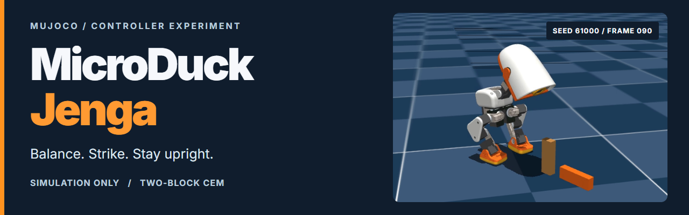
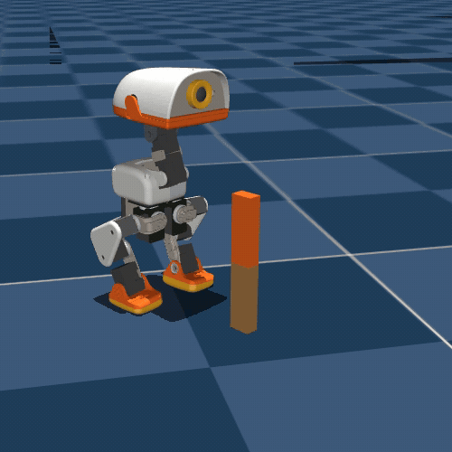
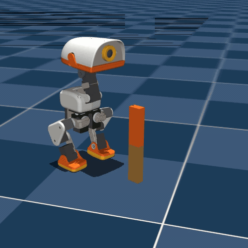
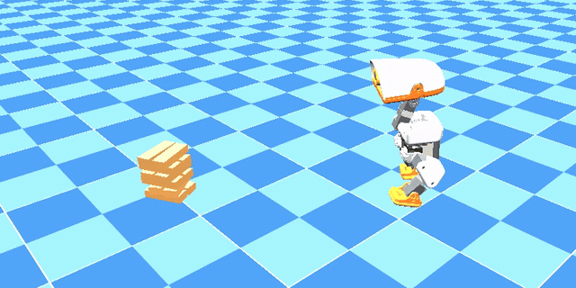
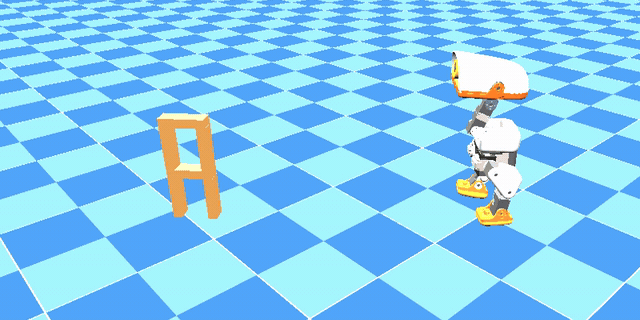
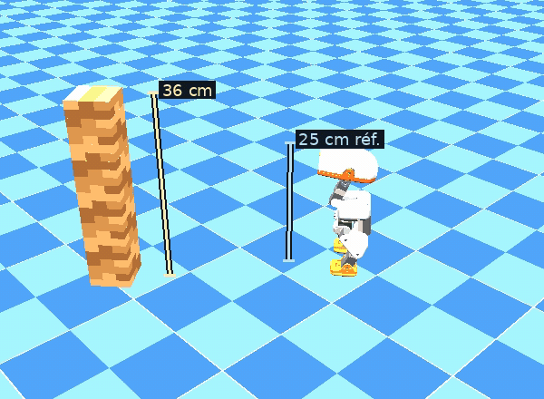

<p align="center">
  
</p>

<p align="center">
  <strong>A tiny biped, a head strike, and a falling block.</strong><br>
  A placement-controlled robotics experiment in MuJoCo.
</p>

<p align="center">
  <a href="#how-it-works"></a>
  <a href="#how-it-works"></a>
  <a href="LICENSE"></a>
  <a href="media/README.md"></a>
</p>

<p align="center">
  <a href="#watch-the-strike">Demos</a> &nbsp; · &nbsp;
  <a href="#more-blocks-and-taller-towers">More towers</a> &nbsp; · &nbsp;
  <a href="#how-it-works">How it works</a> &nbsp; · &nbsp;
  <a href="#results-with-their-limits">Results</a> &nbsp; · &nbsp;
  <a href="#reproduce-the-experiment">Reproduce</a> &nbsp; · &nbsp;
  <a href="#credits-and-license">Credits</a>
</p>

## Watch the strike

The tower is **preassembled**. MicroDuck strikes the upper of two free blocks; it does not build or stack the tower. Both replays below knock the upper block down. Only the first meets the recorded fast-strike criterion.

<table>
  <tr>
    <th align="center" width="50%">Qualifying strike · seed 61000</th>
    <th align="center" width="50%">Below the speed threshold · seed 61001</th>
  </tr>
  <tr>
    <td><a href="media/cem_2block_seed_61000.mp4"></a></td>
    <td><a href="media/cem_2block_seed_61001_failure.mp4"></a></td>
  </tr>
  <tr>
    <td align="center"><strong>0.340 m/s</strong> at first contact<br>Upper block falls; lower block and robot stay standing.<br><a href="media/cem_2block_seed_61000.mp4">Full MP4 ↗</a></td>
    <td align="center"><strong>0.244 m/s</strong> at first contact<br>Block falls, but speed is below the <strong>0.25 m/s</strong> requirement.<br><a href="media/cem_2block_seed_61001_failure.mp4">Full MP4 ↗</a></td>
  </tr>
</table>

<p align="center"><sub>Actual simulation recordings, cropped for readability. Full six-second trials at original speed; GIFs use 25 fps, MP4s use 50 fps.<br>MicroDuck models © Pollen Robotics · footage and derived images: <a href="media/README.md">CC BY-NC-SA 4.0 / attribution & provenance</a>.</sub></p>

### More blocks and taller towers

These earlier **whole-tower experiments** use scripted camera/ToF approach and push commands over frozen learned locomotion. They are separate from the two-block CEM strike above and the three-block selective PPO task. These are individual development trials, not success-rate estimates.

#### Gapped stack · 12 blocks · 9 cm

<p align="center">
  <a href="media/tower_gapped_stack.mp4"></a><br>
  <strong>Contact and partial knockdown.</strong> Robot upright; residual stack ≈ 3.5 cm.<br>
  Strict complete-collapse check fails.<br>
  <a href="media/tower_gapped_stack.mp4">Full 20 s MP4 ↗</a> · GIF: 2–12 s
</p>

#### Open portal · 6 blocks · 18 cm

<p align="center">
  <a href="media/tower_open_portal.mp4"></a><br>
  <strong>Contact and partial knockdown.</strong> Robot upright; residual stack ≈ 3.5 cm.<br>
  Strict complete-collapse check fails.<br>
  <a href="media/tower_open_portal.mp4">Full 20 s MP4 ↗</a> · GIF: 2–12 s
</p>

#### Tall tower · 72 blocks · 36 cm

<p align="center">
  <a href="media/tower_36cm_scaled.mp4"></a><br>
  <strong>No tower contact.</strong> Robot stays upright; tower stays standing.<br>
  24 layers; separate resized simulation profile with a 25 cm reference-pose robot.<br>
  <a href="media/tower_36cm_scaled.mp4">Full 28 s MP4 ↗</a> · GIF: 10–22 s
</p>

The GIFs are contiguous excerpts at recorded speed, replaying saved simulation states. The tall overview uses contrasting block tints for readability. All three use 7.5 × 2.5 × 1.5 cm blocks; the first two retain the original robot scale. No complete-collapse victory or physical robot test is established. [Source recordings, measured outcomes and scale/collider caveats](media/README.md#whole-tower-experiments) · [Evidence excerpt](media/tower-experiments.json).

## How it works

| 01 / Balance | 02 / Strike | 03 / Measure |
| :--- | :--- | :--- |
| A **frozen pretrained VelStand policy** keeps the robot balanced. | **Cross-entropy method (CEM)** optimizes head-trajectory parameters and timing. | Evaluation checks first-contact speed, block separation, lower-block stability, forbidden contacts and robot falls. |

The two-block controller starts at a controlled **14 cm placement** and uses **ideal simulated bearing**. It combines a parameterized head trajectory with the balance policy and does not use camera/ToF localization. No physical robot tests or end-to-end PPO success are claimed for it.

This repository also contains a **separate three-block PPO environment**. That experiment has no established successful policy; its diagnostic results are tracked separately below.

## Results, with their limits

| Two-block historical CEM evaluation | Recorded outcome |
| :--- | :--- |
| Strict successes | **25 / 30 new reset seeds · 83.3%** |
| Wilson 95% interval | **66.4%–92.7%** |
| Head contact / upper block fallen | **30 / 30** for each |
| Fast-strike criterion met | **25 / 30** |
| Robot falls / lower-block failures / forbidden contacts | **0 / 30** for each |
| Test conditions | Two free blocks, 14 cm placement; **fixed environment startup seed 41** |

The five failures missed the fast-strike requirement. **A falling block alone is not a strict success.** The reset seeds vary episodes within this setup; they do not establish broad startup randomization, transfer to three blocks, or real-world performance.

[Raw 30-reset evaluation](microduck_jenga_faststrike/microduck_jenga/cem/evaluation_30_resets.json) · [Machine-readable summary](microduck_jenga_faststrike/microduck_jenga/cem/evaluation_summary.json) · [Experiment provenance](microduck_jenga_faststrike/microduck_jenga/docs/prior_14cm_evidence.md)

<details>
<summary><strong>Contact checks and fresh-install replay</strong></summary>

Two repeated impacts—one successful and one failed—were compared with CPU MuJoCo at matching simulated positions. Contact flags agreed across 201 sampled physics substeps per case. This supports those sampled contact checks, not every impact, the complete velocity calculation or hardware accuracy.

The candidate source reproduced one success and one failure on the same two reference seeds in a freshly installed locked environment. That is a reproducibility check, not an additional held-out performance estimate.

[Successful contact check](microduck_jenga_faststrike/microduck_jenga/cem/contact_check_61000.json) · [Failed contact check](microduck_jenga_faststrike/microduck_jenga/cem/contact_check_61001.json) · [Two-seed replay](microduck_jenga_faststrike/microduck_jenga/cem/candidate_replay_2_seeds.json) · [Measurement caveats](microduck_jenga_faststrike/microduck_jenga/docs/prior_14cm_evidence.md)

</details>

<details>
<summary><strong>Three-block PPO: diagnostic checks, no successful policy established</strong></summary>

These results belong to a different task and must not be combined with the two-block CEM rate.

| Experiment | 14 cm check | Original 20 cm check | Interpretation |
| :--- | :--- | :--- | :--- |
| 100-iteration approach-reward ablation | 0 / 3 | 0 / 3 | Reused diagnostic seeds; one sampled head-contact and lower-block-failure episode per distance. |
| Further 300-update continuation, 128 environments | 0 / 6 | 0 / 6 | Reused and additional diagnostic resets; no sampled head contacts. |

Both are small, fixed-startup-seed diagnostics, **not held-out performance estimates**. PPO contact measurements are sampled at 50 Hz and can miss brief impacts. The continuation changed both training duration and rollout batch size.

[Local training record](microduck_jenga_faststrike/microduck_jenga/docs/local_rtx_training.md) · [Ablation: 14 cm](microduck_jenga_faststrike/microduck_jenga/results/approach20_probe_014.csv) / [20 cm](microduck_jenga_faststrike/microduck_jenga/results/approach20_probe_020.csv) · [Continuation summary](microduck_jenga_faststrike/microduck_jenga/results/continuation300_summary.json) · [Continuation: 14 cm](microduck_jenga_faststrike/microduck_jenga/results/continuation300_probe_014.csv) / [20 cm](microduck_jenga_faststrike/microduck_jenga/results/continuation300_probe_020.csv)

</details>

## Reproduce the experiment

Use **Linux or WSL2, Python 3.12, a compatible NVIDIA CUDA GPU, and `uv`**. Local experiments used an RTX 2060 SUPER with 8 GB; broader hardware compatibility remains unverified. The code, evidence and videos are included. Robot meshes and third-party pretrained weights are restored separately.

<details>
<summary><strong>1 · Restore assets and install the locked environment</strong></summary>

From the repository root, inspect the restoration plan and review upstream asset/model terms before fetching:

```sh
python tools/restore_assets.py --plan
python tools/restore_assets.py --fetch
cd microduck_jenga_faststrike/microduck_jenga
uv sync --locked
```

The restorer fetches public, hash-verified upstream assets. The locked stack was exercised with mjlab 1.3.0, MuJoCo 3.10.0, MuJoCo Warp 3.8.1, Warp 1.12.0 and PyTorch 2.9.1. Keep the lockfile intact; do not independently change MuJoCo versions.

[Asset/model terms](LICENSE-MODELS.md) · [Upstream code notices](NOTICE.md) · [Training setup](microduck_jenga_faststrike/microduck_jenga/docs/local_rtx_training.md)

</details>

<details>
<summary><strong>2 · Run preparation checks and an optional bounded GPU smoke</strong></summary>

Run from `microduck_jenga_faststrike/microduck_jenga` after installation:

```sh
CUDA_VISIBLE_DEVICES='' uv run python -m unittest discover -s tests -p test_jenga_preparation.py -v
CUDA_VISIBLE_DEVICES='' uv run python scripts/validate_jenga.py
# Optional: five PPO iterations, not a successful-policy demonstration.
# Use a new output directory for every run.
uv run python scripts/local_jenga.py smoke --output /path/to/new/smoke --seconds 900
```

The local runner needs the restored VelStand training checkpoint. It saves logs, hardware samples and checkpoints and does not start paid cloud resources. Historical fresh-install validation passed 22 helper tests, nine CPU physics checks and a five-iteration, 32-environment GPU smoke on the RTX 2060 SUPER. These historical checks are not a claim that every platform works or that physical actuators are safe.

See the [local training record](microduck_jenga_faststrike/microduck_jenga/docs/local_rtx_training.md) for measured results, resume commands and explicit placement settings.

</details>

<details>
<summary><strong>3 · Replay the separate two-block CEM controller</strong></summary>

With the restored balance checkpoint available, run from `microduck_jenga_faststrike/microduck_jenga`:

```sh
uv run python scripts/evaluate_cem.py \
  --checkpoint cem/checkpoint_100.json \
  --output /path/to/new/cem-eval --first-seed 61000 --count 30
uv run python scripts/summarize_cem.py /path/to/new/cem-eval/results.json
```

This replays the historical controller; it does not train an end-to-end PPO policy. Use a fresh output directory and keep selection and held-out evaluation seeds separate. The [provenance record](microduck_jenga_faststrike/microduck_jenga/docs/prior_14cm_evidence.md) explains the high-rate contact monitor and its limitations.

</details>

<details>
<summary><strong>4 · Rebuild the README media without running a simulation</strong></summary>

The GIFs are derived only from the checked-in MP4s. With Python 3.10+, FFmpeg/ffprobe and Node.js/npx on `PATH`, run from the repository root:

```sh
python tools/build_readme_media.py
python tools/build_readme_media.py --check
python tools/build_tower_media.py
python tools/build_tower_media.py --check
```

The banner uses a pinned HyperFrames snapshot; the GIFs use FFmpeg's palette filter. Rebuild the CEM GIFs with `--skip-banner`; the separate tower builder needs only Python and FFmpeg/ffprobe. No simulation assets, model weights or GPU training are needed. See [media provenance and conversion details](media/README.md), the [CEM manifest](media/readme-media.json) and the [tower manifest](media/tower-media.json).

</details>

## Explore the repository

| Start here | What it contains |
| :--- | :--- |
| [Experiment evidence](microduck_jenga_faststrike/microduck_jenga/docs/prior_14cm_evidence.md) | CEM provenance, evaluation conditions and contact checks |
| [Training journal](microduck_jenga_faststrike/microduck_jenga/docs/local_rtx_training.md) | Three-block PPO diagnostics, hardware measurements and limitations |
| [Task and controller code](microduck_jenga_faststrike/microduck_jenga) | Simulation environment, CEM scripts, tests and locked dependencies |
| [Media](media/README.md) | Original MP4s, derived GIFs, attribution and reproducible build settings |

## Credits and license

Built on [Pollen Robotics' microduck_rl](https://github.com/pollen-robotics/microduck_rl), with the upstream source commit and notices preserved in [NOTICE.md](NOTICE.md).

| Material | Terms |
| :--- | :--- |
| Code | [Apache-2.0](LICENSE), with upstream notices retained |
| Pollen Robotics robot models | [CC BY-NC-SA 4.0](LICENSE-MODELS.md); source meshes are **not bundled** |
| Simulation recordings, GIFs and footage-based banner | [CC BY-NC-SA 4.0](https://creativecommons.org/licenses/by-nc-sa/4.0/); [credit, changes and provenance](media/README.md) |
| Third-party pretrained weights | **Not bundled**; their applicable distribution terms must be confirmed |

Related reading: NVIDIA's [Using AI Agents to Teach Robots Like Microduck to Walk in Simulation](https://developer.nvidia.com/blog/using-ai-agents-to-teach-robots-like-microduck-to-walk-in-simulation/) describes a separate workflow. It is background reading, not evidence that this project uses that workflow.
